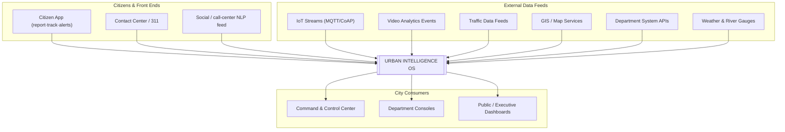
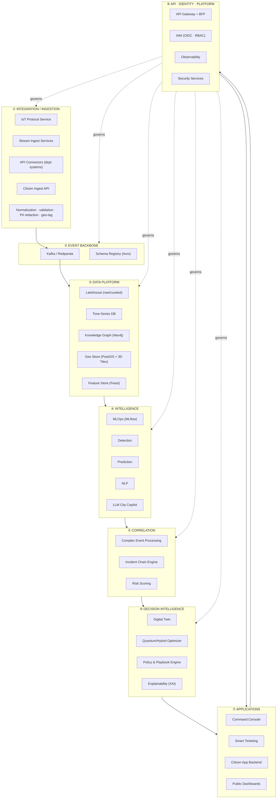
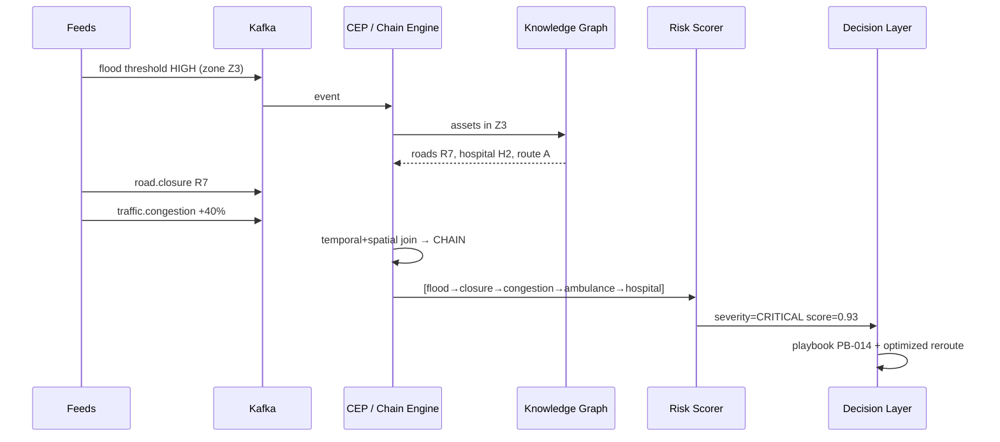
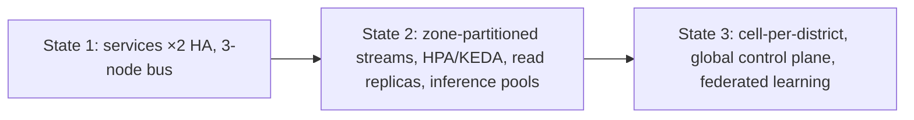

# 01 — MASTER ARCHITECTURE
### Urban Intelligence: AI-Powered City Operating System

**Scope:** Pure software architecture (no hardware/deployment content). Greenfield repo `qsum99/Smart-city`.

> **Runtime note (supersedes infra names below):** default runtime is the **LOCAL profile — no Docker** (12 §0): FastAPI/uvicorn processes, SQLite, in-proc asyncio bus, NetworkX graph, PyJWT auth. Kafka/Neo4j/Postgres/Keycloak/Kong shown in the diagrams are the **PILOT profile (optional escalation)** behind the same interfaces — architecture unchanged, only the infrastructure substitute.

---

## 1. Principles

| # | Principle | Meaning |
|---|---|---|
| P1 | Event-driven | Every city signal becomes an event; services react asynchronously |
| P2 | Loose coupling | Each domain is an independent service — police outage never stops traffic |
| P3 | Horizontal scale | Stateless services + partitioned data; no single point of failure |
| P4 | Intelligence as a platform | ML models are versioned products (MLOps), not scripts |
| P5 | Explainable by default | Every AI action carries rationale (XAI) before human approval |
| P6 | Secure & privacy-first | RBAC, encryption, audit, PII redaction at ingestion |
| P7 | API-first, modular | Every capability is a versioned service; departments plug in without rip-and-replace |

---

## 2. System Context (Level 1)

**Contract:** Ingest everything → understand connections → predict consequences → recommend action (with reasons) → humans approve → execute & learn.

---

## 3. Container Architecture (Level 2) — 8 Layers

---

## 4. Layer Summary

| Layer | Key components | Primary tech |
|---|---|---|
| ① Ingestion | IoT protocol service, stream ingest, API connectors, citizen API, normalization + PII redaction | EMQX/Mosquitto, custom microservices |
| ② Event backbone | Topics: telemetry / vision.events / citizen.reports / dept.alerts / incident.commands / model.predictions; Avro schemas; **partition by geo-zone** | Kafka/Redpanda + Schema Registry |
| ③ Data platform | Lakehouse (raw/curated), time-series, **City Knowledge Graph**, geo store, feature store | Iceberg+MinIO, TimescaleDB, Neo4j, PostGIS, Feast |
| ④ Intelligence | Detection, prediction (traffic/flood/air/demand), NLP ticketing, LLM copilot, MLOps registry | PyTorch/ONNX, MLflow |
| ⑤ Correlation | CEP windowed joins, **Incident Chain Engine** (graph traversal), risk scoring | Flink/ksqlDB + Neo4j |
| ⑥ Decision | Digital Twin what-if, quantum/hybrid optimizer (QAOA/D-Wave + OR-Tools fallback), playbook engine, XAI | Cesium/3D Tiles, Qiskit/Ocean, SHAP |
| ⑦ Applications | OCC console, smart ticketing, citizen backend, public dashboards | React + WebSocket |
| ⑧ Platform | Gateway, IAM, observability, security | Kong, Keycloak, OpenTelemetry/Prometheus/Grafana |

**Core differentiator:** Layer ⑤ turns isolated events into **correlation chains** (flood→road closure→traffic→ambulance delay→hospital risk) — the "connected intelligence" the market lacks. *Correction (10 §1):* v1 traversal is correlation-by-proximity; links are promoted to **causal-grade** only by passing temporal-precedence + authored causal-template + mechanism + counterfactual gates. Never claim "causal" publicly before precision ≥0.85 on replay goldens.

---

## 5. Incident Chain Sequence

---

## 6. End-to-End Flow (demo scenario)

```mermaid
flowchart LR
    A[Threshold event] --> B[Ingest: validate·geo-tag·redact]
    B --> C[Kafka]
    C --> D[Flood prediction model]
    D --> E{Exceeded?}
    E -- yes --> F[CEP incident + graph correlation]
    F --> G[KG: assets & people in zone]
    G --> H[Chain + risk score]
    H --> I[Twin: simulate 3 options]
    I --> J[Optimizer: best reroute + signal plan]
    J --> K[XAI recommendation + playbook]
    K --> L{Human approval}
    L -- approve --> M[Execute: alerts·dispatch·tickets]
    M --> N[Outcome logged → retrain loop]
```

**Latency budget (p95) — justified per-component, supersedes earlier asserted numbers:** ingest→bus <500ms · correlation window <2s · chain <1s · scoring <300ms → **detect→recommend <4s** · twin is tiered: T1 surrogate <2s, T2 meso <15s, T3 full sim async (never on critical path) · optimization <30s (async) · command ack <5s. All values are targets gated by load-test evidence — demo claims cite the last measured run (**10 §11**).

---

## 7. Software Scalability

| Dimension | Mechanism |
|---|---|
| Ingest | Broker clusters; zone-partitioned topics; stateless validators |
| Compute | K8s HPA on CPU/queue-lag; KEDA on stream lag |
| Data | Downsampling, lakehouse compaction, Redis caches |
| Graph | District sharding + read replicas |
| ML | Pooled training; autoscaled inference; model caching |
| Optimization | Job queue + workers; classical-first, quantum burst |
| Tenancy | Namespace per department; cell per district |
| Geography | Active-active regions; data residency; CDN |

---

## 8. Technology Stack

| Layer | Primary | Reference (see ../resrch) |
|---|---|---|
| IoT messaging | EMQX (Mosquitto pilot) | github-repos-smart-city-frameworks |
| Stream bus | Kafka / Redpanda | — |
| CEP | Flink / ksqlDB | — |
| Lakehouse | Iceberg + MinIO | — |
| Time series | TimescaleDB | — |
| Knowledge graph | Neo4j | — |
| Geo/3D | PostGIS + Cesium + 3D Tiles | 3dcitydb, CesiumGS/cesium |
| Traffic ML | LibCity / pytorch_geometric_temporal / tsl | github-repos-aiml-traffic-energy |
| Forecasting | NeuralForecast / TimesFM | same |
| Vision | YOLO-class + DeepSORT | github-repos-vision-llm-datasets |
| NLP/LLM | CityGPT/UrbanGPT-class RAG | same |
| Quantum | Qiskit Optimization + D-Wave Ocean + OR-Tools | github-repos-quantum |
| MLOps | MLflow + Feast | — |
| APIs/IAM | Kong + Keycloak | — |
| Orchestration | Kubernetes + Istio | — |
| Observability | OpenTelemetry + Prometheus + Grafana | — |

---

## 9. Architecture Decision Records

| ADR | Decision | Rationale |
|---|---|---|
| 01 | Event backbone over sync APIs | Decouples siloed departments (core problem) |
| 02 | Knowledge graph as correlation core | Connected intelligence needs relations, not rows |
| 03 | Hybrid classical-first + quantum with benchmarks | Quantum maturity is early (see resrch dossiers); honesty = trust |
| 04 | Ingest events, not raw payloads | Bandwidth + privacy |
| 05 | Human-in-the-loop for critical actions | Trust & accountability |
| 06 | Modular monorepo → microservices at scale | Speed first, boundaries later |
| 07 | Workflow/rules/notification as dedicated engines (not features) | Avoid hand-rolled spaghetti — see GAP_ANALYSIS A1–A3 |
