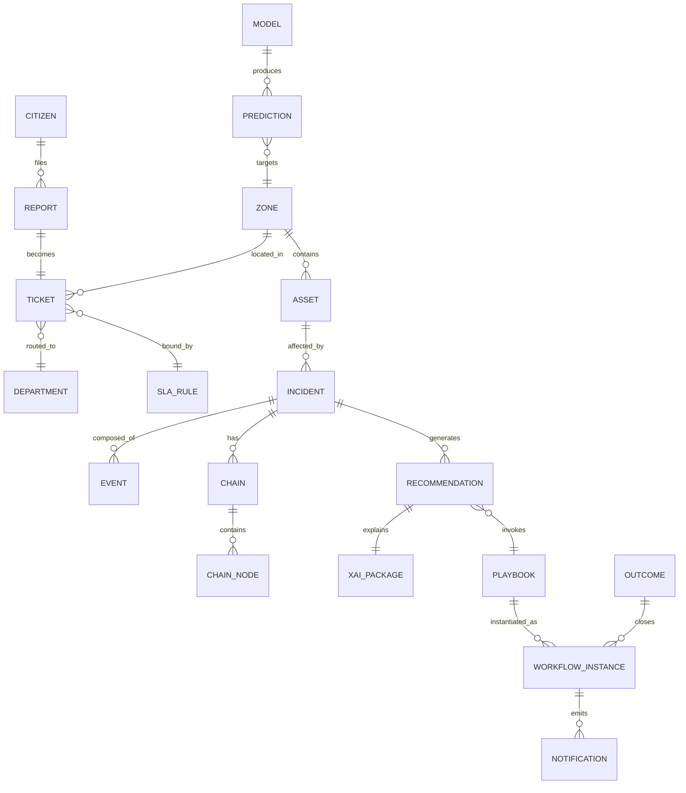

# 08 — DATA MODEL
### Core entities, store mapping, and event schemas

---

## 1. Entity-Relationship (core)



---

## 2. Store mapping

| Entity | Store | Notes |
|---|---|---|
| Citizen, preferences | Postgres | PII encrypted columns |
| Report, Ticket, Timeline | Postgres | SLA fields indexed |
| Incident, Chain, Recommendation, XAI | Postgres (JSONB) + object store (immutable snapshots) | chains are append-only |
| Event (raw/curated) | Kafka → Iceberg lakehouse | Avro, partitioned by zone+day |
| Time series (telemetry, KPIs) | TimescaleDB | continuous aggregates 1m/15m/1h |
| Asset, Zone, relations | Neo4j (graph) + PostGIS (geometry) | dual-write via outbox |
| Media/evidence | Object store (WORM) | hash + chain-of-custody log |
| Search docs | OpenSearch | tickets/incidents/assets indices |
| Models, runs, metrics | MLflow + Feast | versioned |
| Audit | Append-only log (hash-chained) | 7y retention |

---

## 3. Key table sketches (Postgres)

```sql
tickets(
  id ULID PK, type, description, zone_id, geo geography,
  status ENUM(RECEIVED,ASSIGNED,IN_PROGRESS,RESOLVED,CLOSED,ESCALATED),
  dept_id FK, priority INT, sla_due_at, created_at, updated_at,
  reporter_id NULL FK, anonymous BOOL, source_channel,
  incident_id NULL FK, classification JSONB  -- model output
)
timeline(id, ticket_id FK, at, state, actor, note)

incidents(
  id ULID PK, type, zone_id, severity NUMERIC(3,2), status,
  detected_at, closed_at, epicenter geography, source_events TEXT[],
  chain_confidence NUMERIC(3,2)
)
recommendations(
  id ULID PK, incident_id FK, playbook_id, version,
  status ENUM(PROPOSED,APPROVED,REJECTED,EXECUTED,FAILED),
  expected_impact JSONB, xai JSONB, approved_by, approved_at
)
sla_rules(id, dept_id, category, target_minutes, escalation_path JSONB, version, active)
audit_log(id, at, actor, role, action, entity, before_hash, after_hash, prev_hash)
```

---

## 4. Event schemas (Avro — envelope in 02 §2)

### citizen.report.received
```json
{"report_id":"TCK-...","type":"infrastructure.pothole","text":"...",
 "geo":{"lat":0,"lon":0},"media_refs":[],"channel":"mobile",
 "classifier":{"dept":"PWD","confidence":0.91}}
```

### flood.threshold_exceeded
```json
{"gauge_id":"G-17","zone_id":"Z3","level_m":4.8,"threshold_m":4.5,
 "trend_cm_h":12,"forecast_peak_at":"...","model":"M-FLOOD@1.3.0"}
```

### incident.created
```json
{"incident_id":"INC-...","type":"flood","zone_id":"Z3","severity":0.93,
 "event_ids":["e1","e2","e3"],"detected_at":"...","detection_lag_s":112}
```

### incident.chain.updated
```json
{"incident_id":"INC-...","chain_id":"CHN-...","nodes":[
  {"ref":"evt:e1","kind":"flood.threshold"},
  {"ref":"road:R7","kind":"road.closure"},
  {"ref":"tr:R7","kind":"traffic.congestion","delta_pct":40}],
 "confidence":0.89,"engine_ver":"chain@0.4.0"}
```

### recommendation.proposed
```json
{"rec_id":"REC-...","incident_id":"INC-...","playbook":"PB-014",
 "impact":{"ambulance_delay_avoided_min":14},"xai_ref":"xai://pkg/...",
 "confidence":0.87,"requires_approval":true}
```

### workflow.state_changed
```json
{"instance_id":"WF-...","incident_id":"INC-...","state":"EXECUTING",
 "playbook":"PB-014","v":3,"actor":"op:ravi","timer_due_at":"..."}
```

### notification.delivery
```json
{"notif_id":"...","channel":"push","template":"incident_update_v2",
 "recipient":"pseudonym:abc","status":"DELIVERED","attempt":1}
```

### outcome.captured
```json
{"instance_id":"WF-...","success":true,"time_to_resolve_min":38,
 "recurrence_7d":false,"operator_note":"...","labeled_at":"..."}
```

---

## 5. Knowledge Graph schema (Neo4j)

**Nodes:** `Zone`, `Asset` (subtypes: Road, Pipe, Hospital, School, Pump, Signal, Bin, Station), `Person` (operator, pseudonymous citizen), `Incident`, `Event`, `Ticket`, `Playbook`

**Relationships (the chain vocabulary):**
| Rel | Meaning | Example chain edge |
|---|---|---|
| `CONNECTED_TO` | physical/network link | R7 CONNECTED_TO bridge B2 |
| `BLOCKS` | obstruction relation | flood BLOCKS R7 |
| `SERVES` | service coverage | pipe P9 SERVES zone Z3 |
| `FEEDS` | flow/topology | tributary FEEDS river G1 |
| `DEPENDS_ON` | functional dependency | hospital H2 DEPENDS_ON road R7 (access) |
| `LOCATED_IN` | containment | asset LOCATED_IN zone |
| `AFFECTED_BY` | incident impact | amb:12 AFFECTED_BY INC-000912 |

**Chain algorithm:** BFS from epicenter, depth ≤4, edge whitelist per incident type, max 50 nodes, score = Σ(asset criticality × population) × temporal decay.

---

## 6. Retention & lifecycle

| Data | Hot | Warm | Archive | Delete |
|---|---|---|---|---|
| Telemetry | 7d (bus) | 90d (Parquet) | 1y lake | purge after 1y (minimization) |
| Incidents/chains | 90d DB | 1y | 5y | per policy |
| Media evidence | 90d | — | case-linked longer | auto-purge |
| Tickets | DB 1y | archive | 3y | anonymize at 1y |
| Audit log | — | — | 7y | never (tamper-evident) |
| Citizen PII | active | — | — | delete-on-request (SLO 30d) |

*Outbox pattern for dual-writes (Postgres→Neo4j/Kafka); Debezium CDC where feasible.*
