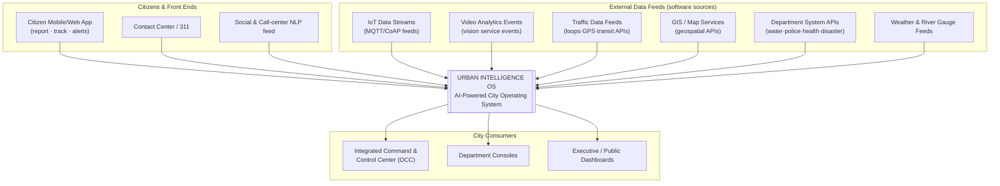
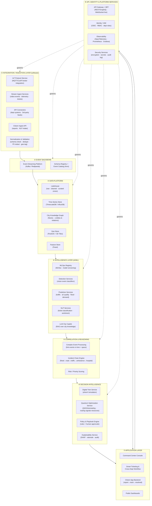
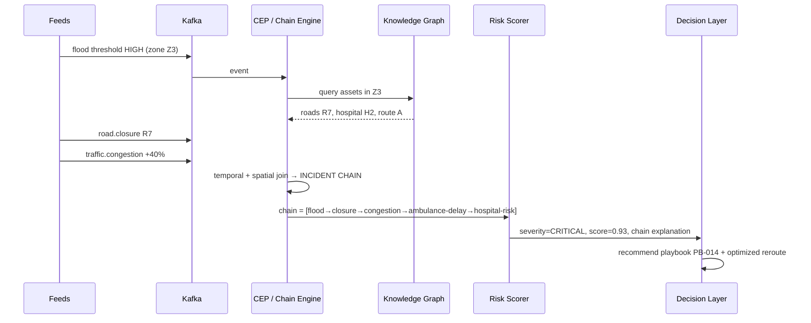
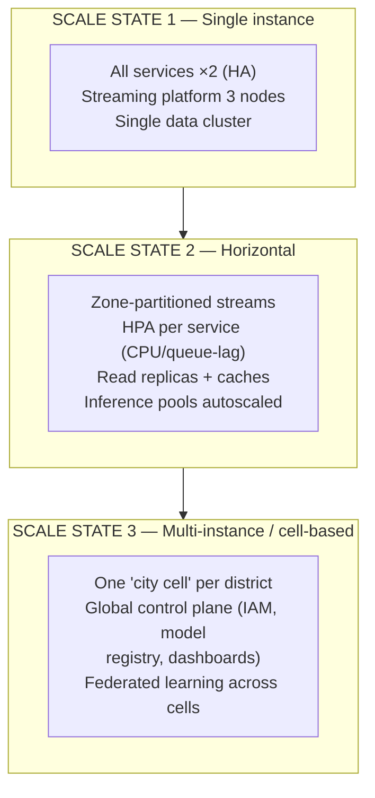

# URBAN INTELLIGENCE — AI-POWERED CITY OPERATING SYSTEM
## Complete Software Architecture (HLD) — Pure Software, Fully Scalable

**Project:** Cortisol Override — HIMOVATION 2026 Solve-a-Thon
**Theme:** AI for Smart Cities
**Scope:** 100% software system (no hardware/deployment content) — greenfield repo `qsum99/Smart-city`

---

# 1. Software Architecture Principles

| # | Principle | Meaning |
|---|---|---|
| P1 | **Event-driven** | Every city signal becomes an event on a backbone; services react asynchronously |
| P2 | **Loose coupling, high cohesion** | Each domain is an independent service — a police outage never stops traffic |
| P3 | **Scale horizontally, fail gracefully** | No single point of failure; stateless services + partitioned data |
| P4 | **Intelligence as a platform** | ML models are versioned products (MLOps), not embedded scripts |
| P5 | **Explainable by default** | Every AI action carries provenance + rationale (XAI) before human approval |
| P6 | **Secure & privacy-first** | RBAC, encryption, audit trails, PII redaction at ingestion |
| P7 | **API-first & modular** | Every capability is a versioned service; departments plug in via standard APIs |

---

# 2. System Context (Level 1)

**One-line contract:** *Ingest everything → understand connections → predict consequences → recommend action (with reasons) → humans approve → execute & learn.*

---

# 3. Container Architecture (Level 2) — The 8 Software Layers

---

# 4. Layer Specifications (Software Only)

## ① Integration / Ingestion Layer — *unified entry point for all data*
| Service | Responsibility |
|---|---|
| **IoT Protocol Service** | MQTT/CoAP broker integration (EMQX/Mosquitto), device-session management, topic→event mapping |
| **Stream Ingest Services** | Consume video-analytics events, telemetry, external feeds → validate → publish |
| **API Connectors** | Push/push connectors for each department system (REST, webhook, CDC-based where available) |
| **Citizen Ingest API** | Report submission (text/image/location), rate limiting, abuse protection |
| **Normalization & Validation** | Schema enforcement (Avro), deduplication, geo-tagging, **PII redaction** before storage |

*All components are stateless microservices — scale by adding replicas.*

## ② Event Backbone — *the nervous system*
- **Kafka / Redpanda** topics: `raw.telemetry`, `vision.events`, `citizen.reports`, `dept.alerts`, `incident.commands`, `model.predictions`
- **Schema Registry (Avro)** — contract-first evolution; every event versioned
- Exactly-once for commands; at-least-once for telemetry
- **Scale: partition by city zone (geo-hash)** → ordered per zone, parallel across zones
- Retention tiers: hot (7d) → warm (90d, object storage) → archive (Parquet)

## ③ Data Platform — *the memory*
| Store | Data | Purpose |
|---|---|---|
| **Lakehouse** (raw/cleaned/curated) | All events, historical archives | One copy, many engines (batch + streaming) |
| **Time-series DB** | Sensor readings, KPIs | Fast downsampling & dashboards |
| **City Knowledge Graph (Neo4j)** | Roads, zones, hospitals, assets + relations | **Heart of cross-department correlation** |
| **Geo Store (PostGIS + 3D Tiles)** | Maps, zones, CityGML | Spatial queries & twin rendering |
| **Feature Store (Feast)** | Online/offline ML features | Training/serving consistency |

## ④ Intelligence Layer — *reflexes & predictions*
| Service | Input → Output |
|---|---|
| **Detection Services** | Vision events → classified incidents (waste, parking, crowd, anomaly classes) |
| **Prediction Services** | Time series + graph → forecasts (traffic STGNN-class, air-quality CNN-LSTM-class, flood LSTM-class, demand) |
| **NLP Services** | Text/voice → structured tickets, classification, sentiment |
| **LLM City Copilot** | Natural-language queries → insights/recommended actions (RAG over curated city knowledge) |
| **MLOps (MLflow)** | Model registry, versioning, canary/AB rollout, drift monitoring, retraining pipelines |

*Every model served behind a versioned inference API; shadow → canary → production.*

## ⑤ Correlation & Reasoning — *"connected intelligence" (Slide 2 gap)*

- **Complex Event Processing** (Flink/ksqlDB): windowed joins across topics by geo-zone
- **Incident Chain Engine**: graph traversal over Knowledge Graph → produces the exact chain from Slide 2
- **Risk scoring**: model output + business rules → one prioritized queue for OCC

## ⑥ Decision Intelligence — *the brain*
| Service | Role |
|---|---|
| **Digital Twin Service** | What-if simulation ("close this road — what happens?"); renders via 3D Tiles/Cesium; runs per-domain simulation models (traffic, flood plume) |
| **Quantum Optimization Service** | Async job API: `POST /opt/jobs {type: vrp|tsc|allocation}` → QUBO → **QAOA (Qiskit) / D-Wave** with **classical OR-Tools fallback**; use cases: ambulance routing, signal plans, resource deployment; automatic benchmarking of quantum vs classical |
| **Policy & Playbook Engine** | Maps incident → action with guardrails; human-in-the-loop approval for critical actions |
| **Explainability (XAI)** | SHAP attributions + incident-chain narrative + data lineage attached to every recommendation |

## ⑦ Application Layer — *the experience*
- **Command Center Console:** live map, incident chains, recommendations + XAI panel, approval actions (WebSocket push)
- **Smart Ticketing:** auto-routing to the responsible department, SLA timers, cross-dept workflows (solves "citizens don't know who is responsible")
- **Citizen App Backend:** report → auto-classify → track → resolution notification
- **Public Dashboards:** open KPIs (ISO 37120-aligned indicators)

## ⑧ API, Identity & Platform Services
- **API Gateway + BFF** (Kong/Envoy): rate limiting, versioning, WebSocket for live views
- **IAM (Keycloak):** OIDC, RBAC by department/role, citizen pseudonymous IDs, audit log on every read/write
- **Observability:** OpenTelemetry traces (follow an incident end-to-end), Prometheus metrics, Grafana
- **Security:** TLS in transit, encryption at rest, secrets vault, tamper-evident audit log

---

# 5. End-to-End Data Flow (the demo scenario)

```mermaid
flowchart LR
    A[Threshold event:<br/>heavy rain / river spike] --> B[Ingest: validate +<br/>geo-tag + PII redact]
    B --> C[Kafka<br/>raw.telemetry]
    C --> D[Flood prediction model]
    D --> E{Threshold<br/>exceeded?}
    E -- yes --> F[CEP: create incident<br/>+ graph correlation]
    F --> G[Knowledge Graph:<br/>assets & people in zone]
    G --> H[Impact chain +<br/>risk score 0.93]
    H --> I[Digital Twin:<br/>simulate 3 options]
    I --> J[Quantum/classical optimizer:<br/>best reroute + signal plan]
    J --> K[XAI recommendation +<br/>playbook PB-014]
    K --> L{Human approval<br/>in OCC}
    L -- approve --> M[Execute: commands, alerts,<br/>dispatch, citizen push]
    M --> N[Smart tickets to<br/>water/traffic/police/health]
    N --> O[Outcome logged →<br/>model retraining loop]
```

**Latency budget (p95, software pipeline):**
| Stage | Target |
|---|---|
| Ingest → event on bus | < 500 ms |
| Prediction inference | < 2 s |
| Correlation + chain | < 3 s |
| Twin simulation (3 options) | < 30 s |
| Optimization job (quantum/classical) | < 60 s (async) |
| **Human decision** | **variable (by policy)** |
| Command execution ack | < 5 s |

---

# 6. Software Scalability — How It Grows 10×

### Scaling levers (per dimension)
| Dimension | Mechanism |
|---|---|
| **Ingest** | Broker clustering + zone-partitioned topics; validation/dedupe spread across stateless replicas |
| **Compute** | Stateless microservices → K8s HPA on CPU/queue-lag; KEDA autoscale on stream lag |
| **Data** | Time-series downsampling; lakehouse compaction; Redis caches for dashboard reads |
| **Graph** | District-sharded knowledge graph; read replicas for dashboards |
| **ML** | Pooled GPU training jobs; autoscaled CPU/GPU inference pods; model caching |
| **Optimization** | Job queue + worker pools; classical-first with quantum burst capacity |
| **Multi-tenancy** | Namespace-per-department; cell-per-district isolates noisy neighbors |
| **Geography** | Active-active regions; data residency; CDN for public dashboards |

---

# 7. Technology Stack (software)

| Layer | Primary choice | Alternatives | Research reference (in this folder) |
|---|---|---|---|
| IoT messaging | **EMQX** | Mosquitto | `github-repos-smart-city-frameworks.md` |
| Stream bus | **Kafka / Redpanda** | — | — |
| CEP | **Flink / ksqlDB** | — | — |
| Lakehouse | **Iceberg + MinIO/S3** | — | — |
| Time series | **TimescaleDB** | InfluxDB | — |
| Knowledge graph | **Neo4j** | — | — |
| Geo/3D | **PostGIS + Cesium + 3D Tiles** | 3DCityDB | `github-repos-smart-city-frameworks.md` |
| Traffic ML | **LibCity / pytorch_geometric_temporal / tsl** | — | `github-repos-aiml-traffic-energy.md` |
| Forecasting | **NeuralForecast / TimesFM** | OpenSTEF | same |
| Vision events | **YOLO-class classifiers + DeepSORT** | SAMgeo | `github-repos-vision-llm-datasets.md` |
| NLP/LLM | **CityGPT/UrbanGPT-class RAG** | — | same |
| Federated training (later) | **Flower** | FedML | same |
| RL control (later) | **RESCO / sumo-rl / CityLearn** | CityFlow | `github-repos-rl.md` |
| Quantum optimization | **Qiskit Optimization + D-Wave Ocean + OR-Tools** | QOptLib benchmarks | `github-repos-quantum.md` |
| MLOps | **MLflow + Feast** | — | — |
| APIs / IAM | **Kong + Keycloak** | — | — |
| Orchestration | **Kubernetes + Istio** | — | — |
| Observability | **OpenTelemetry + Prometheus + Grafana** | — | — |

---

# 8. Security & Governance (architecture-level)

1. **Network zones:** public / DMZ / platform / department namespaces with enforced policies
2. **Identity:** OIDC SSO for city staff; citizen pseudonymous IDs; credentials for data feeds
3. **RBAC matrix:** traffic operator sees traffic + incident chains; cannot execute health playbooks
4. **Data protection:** PII redaction at ingestion; column-level masking; encryption in transit/at rest; tamper-evident audit trail on every recommendation & approval
5. **AI governance:** model registry with approval gates, drift alerts, human-in-the-loop for critical actions, XAI packet stored with each decision (**the "AI must be trusted" challenge from Slide 2**)
6. **Resilience:** graceful degraded modes (rules-only when models unavailable), dead-letter queues, circuit breakers between services

---

# 9. Architecture Decision Records

| ADR | Decision | Rationale |
|---|---|---|
| ADR-01 | Event-driven backbone (Kafka) over sync APIs | Decouples siloed departments — the core Slide-2 problem |
| ADR-02 | Knowledge graph as correlation backbone | Cross-department "connected intelligence" needs relations, not rows |
| ADR-03 | Hybrid classical+quantum optimizer with benchmarks | Quantum is early-maturity for city problems (research dossier) — classical-first keeps production honest |
| ADR-04 | Ingest events only, not raw payloads | Bandwidth + privacy (PII redaction at the boundary) |
| ADR-05 | Human-in-the-loop for critical actions | Trust + accountability (Slide 2: "AI needs to be trusted") |
| ADR-06 | Modular monorepo → microservices when scaled | Hackathon speed now, scale boundaries later |

---

# 10. Diagram Pack (for slides / documentation)

1. **System context** (§2) — who interacts with the OS
2. **8-layer container view** (§3) — the core architecture slide
3. **Incident chain sequence** (§4⑤) — how connected intelligence works
4. **End-to-end flood flow** (§5) — the demo narrative
5. **Software scale-out states** (§6) — scalability story for judges

---

*Companion research: `SMART_CITY_RESEARCH_REPORT.md` + 7 technical dossiers + 6 GitHub-repo dossiers in this folder.*
